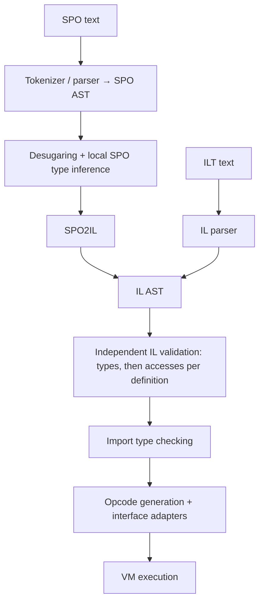

# Architecture and Navigation

## Directories

| Path | Responsibility |
| --- | --- |
| `SPO_CS/src/` | Language: tokenizer, parser, ASTs, type/access checking, lowering, opcodes, VM, modules |
| `SPO_CS/src/Common/` | Custom streams, persistent maps/trees, Maybe/Result, parser combinators, arenas, filesystem access, test framework |
| `SPO_CS/TestFiles/` | Executable SPO/ILT fixtures, results, diagnostics, group-local `_Modules` |
| `SPO/Apps/`, `SPO/Libs/` | SPO applications and shared libraries/SIG contracts |
| `SPO/src/`, `SPO/Runtime/`, `SPO/Tests/` | Launcher/module graph, runtime plugins, native backends, app/host tests |
| `VSCode_Extension/server-src/`, `VSCode_Extension/src/` | C# language server and JS client; server uses compiler sources |
| `doc/`, `index.wiki`, `index.html`, `js/` | Wiki sources and browser viewers; local server: `StaticHTTP_Server.cs` |
| `TestRunner/` | Separate IDE test adapter; primary language-test entry point is `mRunTests.cs` |

## Compiler Pipeline

- Entry point: [mSPO_Interpreter.cs](../SPO_CS/src/mSPO_Interpreter.cs), `Run`, `Check`, `TryToILT`.
- `Check` checks the import pattern, then commands; lowering uses the resulting type state. Successfully emitted IL has passed independent IL validation.
- `.ILT` is readable IL text, not an opcode/binary format. SPO and ILT share the checker, backend, and VM.

## Files by Responsibility

All files below are in `SPO_CS/src/`.

| File / entry point | Change here for |
| --- | --- |
| [mTokenizer.cs](../SPO_CS/src/mTokenizer.cs) | Tokens, source positions, file context for SIG loading |
| [mSPO_Parser.cs](../SPO_CS/src/mSPO_Parser.cs), [mSPO_AST.cs](../SPO_CS/src/mSPO_AST.cs) | Surface syntax, patterns, AST data |
| [mSPO_Desugar.cs](../SPO_CS/src/mSPO_Desugar.cs) | Syntax sugar, pipes, normalized call forms |
| [mSPO_AST_Types.cs](../SPO_CS/src/mSPO_AST_Types.cs): `UpdateTypes`, `UpdatePatternTypes`, `UpdateCommandTypes` | SPO inference, scope bindings, match coverage, SIG witnesses |
| [mVM_Type.cs](../SPO_CS/src/mVM_Type.cs) | Shared type representation, kinds, subtyping, equality, substitution, inference |
| [mSPO2IL.cs](../SPO_CS/src/mSPO2IL.cs): `MapModule`, `MapMethod`, `InitLocalCall` | Lowering, closure environments, IF/MATCH helpers, type declarations |
| [mIL_AST.cs](../SPO_CS/src/mIL_AST.cs), [mIL_Parser.cs](../SPO_CS/src/mIL_Parser.cs) | IL data, text output, ILT grammar |
| [mIL_TypeChecker.cs](../SPO_CS/src/mIL_TypeChecker.cs): `AreModuleTypesValid`, `AreImportTypesValid` | Independent IL safety checking and link contracts |
| [mIL_GenerateOpcodes.cs](../SPO_CS/src/mIL_GenerateOpcodes.cs): `GenerateOpcodes`, `Adapt` | VM registers, constants, opcodes, actual interface restriction |
| [mVM_Data.cs](../SPO_CS/src/mVM_Data.cs) | Runtime values, procedures, opcodes, `_IsMutable` |
| [mVM.cs](../SPO_CS/src/mVM.cs): `TryRun`, `RunValidModule`, `RunModule` | Execution, runtime matching, invariants |
| [mModule.cs](../SPO_CS/src/mModule.cs): `Check`, `Link`, `Init` | Check, link, initialize file modules; cache results/errors |

## State and Phase Boundaries

| State | Meaning / boundary |
| --- | --- |
| SPO scope | Name bindings with value type and optional type-level value; extended locally, no global symbol table |
| `tTypeState.ValidatedTypes` | Persistent AST identity → inferred type; hash collisions handled through buckets and reference equality |
| AST annotations/metadata | Declared annotations are separate from inferred state; `HeadValue`/`TypeValue` still support lowering |
| IL `TypeDef` | Names → value IDs, types/symbolic values; materializes operand types **at each use site** |
| IL `AreDefAccessesValid` | Separate pass: access facts per value ID, local cell IDs and cell contents; no name table |
| Opcode generation | Own register/constant layout; uses original IL, not the temporary typed body |
| `mModule.tModuleSetup` | `Checked`, `IL`, `Module`; distinguish unchecked/success/failure. Cache belongs to the loader, not the compiler |

- Retain persistent updates, e.g. `Tree = Tree.Set(...)`; previous snapshots remain valid.
- Free-type bindings live in inference maps. Do not add mutable binding references to type variables.
- Per IL definition: check the entire body's types, then accesses; definitions follow source order. Type errors take precedence within a body.

## Follow Changes Through the Pipeline

- New SPO syntax: tokenizer/parser → AST → desugar → SPO checker → lowering; check navigation/highlighting.
- New IL command: AST/text → parser → type rule **and** access rule → opcodes → VM; add a direct ILT fixture.
- Type semantics: consider `mVM_Type`, both checkers, lowering, and runtime matches.
- Successful SPO parsing alone does not establish safety; consider direct ILT inputs and the C# VM API separately.
- Unfinished examples: IL `TypeCond` is rejected; `ASSERT` is not a complete proof checker. Refinements, parallelism, and native backends remain development goals.